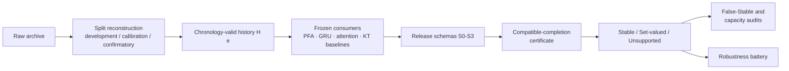

<div align="center">

# What Did the Log Forget?

### Empirical Decision Identifiability under Lossy Educational Event Releases

*Which pedagogical decisions survive when an educational event log drops the fields a model was trained on?*


</div>

---

## Overview

Educational platforms routinely publish event logs that keep item identity and binary correctness but drop finer action detail: selected options, hint counts, attempt counts, within-attempt action tokens. A downstream model trained on the full log is then evaluated on the lossy release, and the pedagogical decision it drives (for example *mastered / not yet mastered* at threshold τ) may or may not be identified by what remains.

This repository implements an **empirical identifiability audit** for that situation:

1. **Release schemas.** A nested lattice of lossy views of one event, S0 to S3, ordered from the coarsest release (S0) to the most detailed (S3).
2. **Compatible completions.** For a released event, the set of full events observed in a disjoint development split that project to the same release key.
3. **Decision certificates.** A frozen consumer scores every supported completion. The event is **Stable** if all completions yield the same action at τ = 0.80, **Set-valued** if they disagree, and **Unsupported** if the development split offers too little evidence. Event NC (non-certified) = Unsupported + Set-valued.
4. **Audits.** False-Stable rates against realized outcomes, learner-level capacity certificates (guaranteed-in / guaranteed-out / unresolved), and a large battery of robustness analyses.



## Headline results

All numbers below come from the chronology-valid ASSISTments 2012-13 protocol: **939,910 source events**, 91 invalid intervals removed, **939,819 valid confirmatory targets** from **6,766 held-out learners**. History for an event contains only the same learner's interactions that *finished* before the event started. They are regenerated by `./reproduce.sh stages` and checked by `./reproduce.sh verify`.

### Event NC rate by release schema (τ = 0.80)

| Consumer | S0 | S1 | S2 | S3 |
|---|---:|---:|---:|---:|
| TransparentActionPFA | **2.44%** | 8.29% | 8.60% | 10.71% |
| ActionTokenGRU | **13.75%** | 9.90% | 10.18% | 10.71% |
| CausalTokenAttentionKT | **18.78%** | 14.02% | 14.30% | 10.71% |

Unsupported events are a property of the release lattice (20,408 at S0, 77,877 at S1, 80,790 at S2, 100,688 at S3), identical for every consumer. At S3 every supported event is Stable because no completion ambiguity remains, so all three consumers coincide. At S0 the action-conditioned neural consumers disagree with themselves across completions far more often than the count-based transparent model does.

### Certified decisions and False-Stable events (τ = 0.80)

| Consumer / schema | Stable | Set-valued | Unsupported | False-Stable |
|---|---:|---:|---:|---:|
| TransparentActionPFA / S0 | 916,845 | 2,566 | 20,408 | 45 |
| TransparentActionPFA / S1 | 861,927 | 15 | 77,877 | 0 |
| ActionTokenGRU / S0 | 810,576 | 108,835 | 20,408 | 1,077 |
| ActionTokenGRU / S1 | 846,772 | 15,170 | 77,877 | 252 |
| ActionTokenGRU / S2 | 844,157 | 14,872 | 80,790 | 250 |
| ActionTokenGRU / S3 | 839,131 | 0 | 100,688 | 0 |
| CausalTokenAttentionKT / S0 | 763,342 | 156,069 | 20,408 | 1,579 |

False-Stable means a Stable certificate whose issued action disagrees with the action implied by the realized outcome. It is rare in absolute terms (0.13% of Stable events for the GRU at S0) but it is concentrated in the coarsest release schema.

### Predictive quality of the consumers

| Consumer | AUROC | Notes |
|---|---:|---|
| ActionTokenGRU (action-conditioned) | 0.979 | current actions visible, outcome token withheld |
| ACT / LEN / HIST (matched-information GRUs) | 0.977 / 0.971 / 0.674 | history + current action tokens / history + current action count / history only |
| DKT / AKT / SAKT-KC | 0.705 / 0.703 / 0.692 | published KT baselines on the same pre-action task |
| CanonicalPFA40 / CountEncodedGRU | 0.677 / 0.670 | matched-estimand controls on (skill, S, F) only |
| ActionTokenLogit | 0.954 | transparent control on the original token interface |
| BKT-40 | 0.625 | |

Most of the predictive signal comes from the *current event's action pattern*, not from learner history. That is exactly the information a lossy release removes, which is why the certificate, rather than an accuracy number, is the right object to audit.

### Eedi (selected-option omission)

| Quantity | Value |
|---|---:|
| Supported held-out events | 138,039 |
| TransparentActionPFA Stable | 138,028 |
| CategoricalDKT Set-valued | 5,303 |

### ASSISTments file-order reference

The original evaluation walked each learner's events in stored file order. The chronology-valid protocol replaces it as the primary analysis; the file-order tables are kept under `results/wdlf_r*` for comparison (`results/assistments/chronological_replication/historical_vs_chronological_comparison.csv`). For the GRU at S0 the file-order replay gives 1,539 False-Stable events (0.192% of Stable, learner-clustered 95% CI 0.171%–0.216%); the chronology-valid run gives 1,077.

## Analyses included

| Analysis | Script | Question |
|---|---|---|
| Source reconstruction | `scripts/assistments/source_reconstruction.py` | Rebuild the splits and release geometry from the raw archive |
| Temporal analysis | `scripts/assistments/temporal_forensics.py` | How often does stored order expose future-dated history? |
| Chronological protocol | `scripts/assistments/chronological_protocol.py` | Interval contract and calibration pilot |
| Chronological replication | `scripts/assistments/chronological_replication.py` | Primary S0-S3 frontier, capacity, thresholds, tie rules |
| Matched information | `scripts/assistments/matched_information.py` | History vs. length vs. action signal in the GRU input |
| Seed robustness | `scripts/assistments/seed_robustness.py` | Initialization variance (seeds 17, 29, 41) |
| Attention consumer | `scripts/assistments/attention_consumer.py` | A second neural consumer family |
| Threshold sweep | `scripts/assistments/threshold_false_stable.py` | False-Stable at τ ∈ {0.70, 0.80, 0.90} |
| Release-field ablation | `scripts/assistments/release_field_ablation.py` | Hint-count x attempt-count factorial |
| Support intersection | `scripts/assistments/support_intersection.py` | Exact support-loss overlap of the factorial arms |
| Matched-estimand controls | `scripts/assistments/matched_estimand_controls.py` | Transparent vs. neural consumers on identical inputs |
| KT baselines | `scripts/assistments/kt_baselines.py` | BKT, DKT, SAKT, AKT on the same task |
| Decision baselines | `scripts/assistments/decision_baselines.py` | Modal imputation, conformal action sets, selective prediction |
| Support-predicate robustness | `scripts/assistments/support_predicate_robustness.py` | Sensitivity to the definition of "supported" |
| Fingerprint consistency | `scripts/assistments/fingerprint_consistency.py` | Fingerprint sufficiency and the 70-event transition |
| Certificate reliability | `scripts/assistments/certificate_reliability.py` | Calibration-only issuance with learner-level bounds |
| Behavioral plausibility | `scripts/assistments/behavioral_plausibility.py` | History-conditioned restrictions on the completion library |
| Bootstrap and capacity | `scripts/assistments/bootstrap_capacity.py` | Learner-bootstrap intervals and matched-capacity rank monotonicity |
| Eedi support sensitivity | `scripts/eedi/support_sensitivity.py` | Support-predicate grid on the Eedi release |
| Capacity certification | `scripts/assistments/capacity_certification.py` | Common-cohort guaranteed-in / guaranteed-out labels |

Learner-bootstrap intervals for the behavioral-plausibility frontier are produced by `bootstrap_capacity.py` (rate = resampled Event NC / resampled valid events, 2,000 learner-level replicates, shared draws across consumers, seed 20319).

## Repository layout

```text
.
├── README.md
├── LICENSE
├── requirements.txt
├── reproduce.sh                      # single entry point (see Quick start)
├── SHA256SUMS.txt                    # checksums of every tracked file
├── configs/                          # frozen manifests and the reliability rule
├── experiments/                      # frozen confirmatory manifests
├── src/
│   ├── data/                         # ASSISTments action parser, Eedi split
│   ├── models/                       # PFA-Option, CategoricalDKT
│   ├── policies/                     # mastery policy, capacity support
│   └── identification/compatible_trace/   # certificates and propagation
├── scripts/
│   ├── verify_primary_results.py     # frozen file-order reference numbers
│   ├── verify_chronological_results.py    # chronology-valid headline numbers
│   ├── assistments/                  # all ASSISTments analyses (table above)
│   ├── eedi/                         # Eedi support sensitivity
│   ├── wdlf_r3/  wdlf_r4/  wdlf_r7/  wdlf_r1_rescue/   # frozen certificate core and post-processing
├── prospective/                      # sealed inputs and frozen model parameters (Git LFS)
└── results/
    ├── assistments/<analysis>/       # result tables and frozen checkpoints
    ├── eedi/support_sensitivity/
    └── wdlf_r*/                      # file-order reference results
```

## Quick start

```bash
git lfs install
git clone <this repository> && cd <this repository>
git lfs pull

python3 -m venv .venv && source .venv/bin/activate
pip install -r requirements.txt

./reproduce.sh verify        # checks all frozen headline numbers in seconds
./reproduce.sh checksums     # SHA-256 check of the whole tree
```

`verify` needs no raw data. It confirms the stored certificates, the False-Stable counts, the predictive metrics, and the SHA-256 of the frozen checkpoints.

### Full re-computation

```bash
# 1. Place the raw ASSISTments archive (see Data) and rebuild the splits
./reproduce.sh data

# 2. Re-run every analysis against the frozen checkpoints (several hours on CPU)
./reproduce.sh stages
./reproduce.sh verify

# Single stage, e.g. the threshold sweep
./reproduce.sh stage assistments/threshold_false_stable
```

Stages are ordered; later stages read score caches written by earlier ones. Caches and process records are written next to the result tables and are ignored by git. Re-running a stage regenerates its tables from the frozen checkpoints. Stages check the stored identities (checkpoint and archive SHA-256, population counts) and stop with a blocked status when one does not match.

`./reproduce.sh retrain-primary` retrains the primary chronological GRU from scratch. It overwrites the frozen checkpoint, and every downstream stage pins that checkpoint by SHA-256, so use it only to study training-level variation.

Other modes: `postprocess` (recompute the clustered bootstrap and NC decomposition from frozen inputs), `eedi-unseal`, `assist-integrity`.

## Data

Raw platform archives are not redistributed.

| Dataset | Location | Identity |
|---|---|---|
| ASSISTments 2012-13 (`2012-2013-data-with-predictions-4-final.zip`) | `data/raw/assistments/assistments_2012.zip` | SHA-256 `7bb18f932f97e63c2eb34bb869c44cd4f46f4adec4d7fe02298578dbba572445` |
| Eedi Tasks 3 and 4 joined cache | `prospective/g6p/data/cache/tasks_3_4_joined_min.parquet` (included) | SHA-256 `1388748a532916aed113ec82a17e92b0177c92d9e26230f934716f2fdc0b1f84` |

Obtain the ASSISTments archive from the [official 2012-13 data page](https://sites.google.com/site/assistmentsdata/datasets/2012-13-school-data-with-affect). `./reproduce.sh data` verifies the archive hash and rebuilds three user-disjoint splits, which must match exactly:

| Split | Learners | Events |
|---|---:|---:|
| Development | 31,753 | 4,286,981 |
| Calibration | 6,804 | 888,158 |
| Confirmatory | 6,766 | 939,910 |

The sealed development dictionary and confirmatory split used by the file-order reference evaluation are stored with Git LFS under `prospective/wdlf_r7/sealed/`.

## Frozen artifacts

| Artifact | Path | SHA-256 (prefix) |
|---|---|---|
| Chronological ActionTokenGRU, seed 17 | `results/assistments/chronological_replication/gru_chronological_seed17.pt` | `42f14f14b9d9...` |
| CausalTokenAttentionKT, seed 17 | `results/assistments/attention_consumer/causal_token_attention_seed17.pt` | `8728fb05b333...` |
| File-order ActionTokenGRU, seed 17 | `prospective/wdlf_r7/sealed/checkpoints/action_token_gru_seed17.pt` | `acd9b0c1650c...` |
| Matched HIST / LEN / ACT GRUs | `results/assistments/matched_information/*.pt` | |
| Seed-robustness GRUs (seeds 29, 41) | `results/assistments/seed_robustness/*.pt` | |
| DKT, SAKT-KC, AKT checkpoints | `results/assistments/kt_baselines/trained_baseline_checkpoints/` | |
| Eedi PFA-Option and CategoricalDKT | `prospective/g6p/checkpoints/` | |

## Protocol constants

| Constant | Value |
|---|---|
| Decision threshold τ | 0.80 (sensitivity at 0.70 and 0.90) |
| Support predicate P00 | the release class holds at least 2 development learners **or** at least 2 distinct (timestamp-inclusive) rich signatures |
| Capacity budget | B = max(1, round(κ·n)), κ ∈ {0.01, 0.05, 0.10}; the matched chronological cohort has 6,744 learners (B = 337 at κ = 0.05) |
| Capacity ranks | best = 1 + #{k: lower_k > upper_i}; worst = 1 + #{k: upper_k ≥ lower_i}; adversarial ties |
| Learner bootstrap | 2,000 replicates, learners resampled with replacement |
| Primary neural seed | 17 (robustness: 29, 41) |

Protocols, seeds, thresholds, capacity fractions, and support rules are frozen. If a regenerated statistic disagrees with a stored one, treat that as a reproduction failure.

## Hardware

CPU is sufficient for every stage. `verify` and `checksums` run in seconds. The full `stages` run takes several hours on a laptop-class CPU; the ASSISTments confirmatory population has 939,819 scored targets per consumer and schema, and peak memory can reach 16-32 GB in the sealed-loader stages.

## License

MIT, see [LICENSE](LICENSE). Dataset terms remain those of the original Eedi and ASSISTments distributors.
